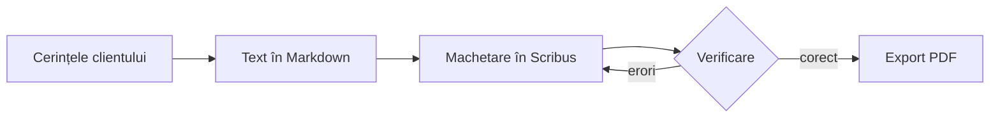

FIȘĂ DE LUCRU – MARKDOWN AVANSAT

Nume și prenume: popa cristian

1. Ce este Markdown avansat?

Markdown avansat reprezintă utilizarea unor elemente suplimentare față de sintaxa de bază, pentru realizarea unor documente complexe și bine organizate.

Cu ajutorul acestuia putem crea:

Tabele cu alinierea textului.
Liste de sarcini cu casete de bifat.
Note de subsol.
Blocuri de cod.
Antete cu metadate.
Formule matematice.
Diagrame și scheme logice.
Documente care pot fi convertite în Word sau HTML.

Scopul este realizarea unui document complet, care poate fi verificat, convertit și publicat.

2. Dialectele Markdown

Markdown are mai multe variante, numite dialecte, deoarece diferite programe au adăugat funcții suplimentare.

CommonMark
Reprezintă specificația sintaxei de bază Markdown.
Stabilește reguli clare pentru interpretarea textului.
Este respectat de numeroase programe.
GFM (GitHub Flavored Markdown)
Este varianta utilizată de platforma GitHub.
Include funcții suplimentare față de CommonMark.
Permite realizarea tabelelor, listelor de sarcini, textului tăiat și legăturilor automate.

Important: Un element avansat poate funcționa într-un program și poate apărea ca text simplu în altul. De aceea, documentul trebuie verificat în programul în care va fi utilizat.

3. Tabele cu aliniere

Tabelele permit organizarea informațiilor în rânduri și coloane.

Se folosesc:

Bara verticală | pentru separarea coloanelor.
Liniuțele - pentru separarea antetului de date.
Două puncte : pentru stabilirea alinierii.
Sintaxă
text
| Element   | Tipar    | Ecran |
|:----------|:--------:|------:|
| Rezoluție | 300 dpi  | 96 dpi |
| Culoare   | CMYK     | RGB |
| Format    | PDF/X-4  | PNG |

Tipuri de aliniere
Sintaxă	Aliniere	Utilizare
:---	La stânga	Texte
:---:	La centru	Valori scurte
---:	La dreapta	Numere și prețuri
Reguli pentru tabele
Toate rândurile trebuie să aibă același număr de coloane.
Se lasă un rând gol înaintea tabelului.
Alinierea barelor în fișierul sursă ajută la citire, dar nu este obligatorie.
O celulă conține, de regulă, un singur rând de text.
Markdown nu este potrivit pentru tabele foarte complexe, cu celule unite sau mai multe paragrafe.
4. Liste de sarcini

Listele de sarcini permit evidențierea etapelor finalizate și a celor care mai trebuie realizate.

Se folosesc:

[x] pentru o sarcină terminată.
[ ] pentru o sarcină neterminată.
Exemplu
text
- [x] Notarea cerințelor clientului
- [x] Scrierea textului
- [ ] Machetarea în Scribus
- [ ] Exportul PDF


Rezultatul este o listă cu căsuțe de bifat.

Reguli
Se folosește o liniuță înaintea parantezelor.
Între paranteze se pune un spațiu sau litera x.
Sintaxa -[] este greșită.
Se lasă un spațiu între liniuță și paranteze.
5. Text tăiat

Pentru a tăia un text fără a-l șterge, se folosesc două simboluri tilde ~~ înainte și după text.

Exemplu:

text
~~Ziua Ușilor Deschise~~


Rezultat: Ziua Ușilor Deschise

Se utilizează pentru:

Variante la care s-a renunțat.
Modificări și corecturi.
Informații care nu mai sunt valabile.
6. Note de subsol

O notă de subsol este o explicație suplimentară, legată de un anumit cuvânt sau fragment din document.

Este formată din două părți:

Trimiterea din text.
Definiția notei, de obicei la sfârșitul documentului.
Sintaxă
text
Fișierul trece prin preflight[^pf]
înainte de tipar.

[^pf]: Preflight – verificarea tehnică
a fișierului înainte de tipar.

Reguli
Trimiterea se scrie sub forma [^nume].
Definiția se scrie sub forma [^nume]: explicație.
Numele poate fi ales de autor.
Numerotarea este realizată automat în ordinea apariției în text.
Fiecare trimitere trebuie să aibă o definiție corespunzătoare.
7. Blocuri de cod

Un bloc de cod este un fragment de text afișat exact așa cum a fost scris, fără ca simbolurile să fie interpretate ca Markdown.

Se folosesc trei accente grave înainte și după fragment.

Exemplu
text
```html
<h1>Ziua Porților Deschise</h1>
<p class="data">24 octombrie</p>
```


Dacă după primele trei accente grave se scrie numele limbajului, programul poate colora automat comenzile și cuvintele-cheie. Această funcție se numește evidențierea sintaxei.

Utilizări
Cod HTML și CSS.
Comenzi de terminal.
Scripturi Python.
Exemple de sintaxă Markdown.
Conținutul altor fișiere.

Atenție: Blocurile de cod nu trebuie confundate cu textul de tip cod din interiorul unui paragraf, care folosește un singur accent grav.

8. Antetul de metadate (Front Matter)

Metadatele sunt informații despre un document, precum:

Titlul.
Autorul.
Data.
Limba.

Antetul de metadate este un bloc plasat chiar la începutul fișierului Markdown, delimitat de două rânduri cu trei liniuțe ---.

Este scris în formatul YAML, în care fiecare informație este exprimată printr-o pereche nume: valoare.

Exemplu
yaml
---
title: "Afiș Ziua Porților Deschise"
author: "Popescu Ana, clasa a XII-a Media"
date: "2026-10-05"
lang: ro
---

Utilizări
Pandoc poate prelua titlul, autorul și data la conversia documentului.
Limba poate fi stabilită cu ajutorul câmpului lang.
Obsidian poate afișa informațiile ca proprietăți ale documentului.
Metadatele ajută la organizarea și identificarea fișierelor.
Reguli
Antetul trebuie să fie pe primele rânduri ale fișierului.
Se folosesc două puncte după numele câmpului.
După două puncte se lasă un spațiu.
Valorile care conțin caractere speciale se pun între ghilimele.
Se folosesc denumiri precum title, author, date și lang.
9. Formule matematice

Formulele se pot scrie folosind notația LaTeX.

Există două variante:

Formula în interiorul unui rând: $...$.
Formula pe rând separat: $$...$$.
Exemplu
text
$$N = \frac{L \cdot R}{25,4}$$


Unde:

N = numărul de pixeli necesar.
L = lungimea laturii tipărite, în milimetri.
R = rezoluția de tipar, exprimată în dpi.
25,4 = numărul de milimetri dintr-un inch.
Exemplu practic

Pentru un afiș A3, cu dimensiunile 297 × 420 mm, tipărit la 300 dpi:

Lățime:

N = (297 × 300) / 25,4 ≈ 3508 pixeli

Înălțime:

N = (420 × 300) / 25,4 ≈ 4961 pixeli

Imaginea de fundal trebuie să aibă cel puțin 3508 × 4961 pixeli.

Simboluri LaTeX importante
Sintaxă	Semnificație
\frac{a}{b}	Fracție
\cdot	Înmulțire
x^2	Exponent
x_1	Indice
\sqrt{x}	Radical
\approx	Aproximativ egal
10. Diagrame Mermaid

Mermaid este un limbaj care permite realizarea diagramelor folosind instrucțiuni scrise sub formă de text.

Avantaje:

Diagramele se modifică ușor.
Nu este nevoie să desenăm manual casetele și săgețile.
Diagrama poate fi păstrată în același fișier cu documentul.
Exemplu de schemă logică
text


Elemente Mermaid
Sintaxă	Semnificație
flowchart LR	Diagramă de la stânga la dreapta
flowchart TD	Diagramă de sus în jos
A[Text]	Casetă dreptunghiulară
D{Text}	Decizie, reprezentată prin romb
A --> B	Săgeată de la A la B
D -- erori --> C	Săgeată cu explicație

Pentru realizarea și testarea diagramelor se poate utiliza site-ul Mermaid Live Editor: https://mermaid.live

Diagramele pot fi salvate ca imagini PNG sau SVG.

11. Imagini, legături și structura folderului

Un document Markdown nu include direct fișierul imaginii, ci doar o trimitere către acesta.

De aceea, documentul și imaginile trebuie păstrate împreună într-un folder de proiect.

Exemplu de structură
text
proiect-afis/
├── README.md
├── imagini/
│   ├── schita.png
│   └── diagrama.png
└── export/
    ├── proiect.docx
    └── proiect.html

Inserarea unei imagini
text


Inserarea unui link către un fișier
text
[Varianta Word](export/proiect.docx)

Calea relativă

Este drumul către un fișier pornind de la folderul documentului.

Exemplu: imagini/schita.png

Calea absolută

Este drumul complet către un fișier, pornind de la rădăcina discului.

Exemplu: C:\Users\Ana\Desktop\schita.png

Reguli pentru organizarea fișierelor
Se folosesc căi relative.
Se utilizează bara /, nu \, în căile relative Markdown.
Numele fișierelor trebuie să fie simple.
Se recomandă litere mici și evitarea diacriticelor.
Cuvintele se separă prin liniuță.
Majusculele contează la publicarea pe internet.

Exemplu: schita-afis.png este preferabil față de Schiță Afiș.png.

12. Pandoc – conversia documentelor

Pandoc este un program gratuit care permite transformarea documentelor dintr-un format în altul.

Poate converti Markdown în:

Word (.docx).
HTML (.html).
EPUB (.epub).
Alte formate de documente.

Pandoc se utilizează prin intermediul liniei de comandă, adică terminalul în care comenzile sunt introduse ca text.

Pregătirea programului
Se descarcă Pandoc de pe https://pandoc.org.
Se instalează programul.
Se deschide folderul proiectului în Visual Studio Code.
Se deschide terminalul din meniul Terminal → New Terminal.
Se verifică instalarea cu:
bash
pandoc --version

Comenzi Pandoc importante
Operație	Comandă
Conversie în Word	pandoc README.md -o proiect.docx
Conversie în HTML	pandoc README.md -s --mathml -o proiect.html
Word cu cuprins	pandoc README.md --toc -o proiect.docx
Word cu șablon	pandoc README.md --reference-doc=sablon.docx -o proiect.docx
Conversie în EPUB	pandoc README.md --mathml -o proiect.epub
Explicația comenzilor
pandoc – numele programului.
README.md – fișierul sursă.
-o – indică fișierul rezultat.
-s – creează un document complet, de sine stătător.
--mathml – permite afișarea formulelor în HTML prin MathML.
--toc – adaugă cuprinsul automat.
--reference-doc – utilizează stilurile unui document Word ca model.
Conversia în PDF

Pentru conversia directă în PDF este necesar un program suplimentar.

Două metode simple:

Se convertește fișierul în Word, apoi se folosește File → Save As → PDF.
Se convertește fișierul în HTML, apoi se deschide în browser și se folosește Ctrl + P → Save as PDF.
Atenție la diagramele Mermaid

Pandoc nu desenează automat diagramele Mermaid la conversia în Word.

Soluția este:

Diagrama se deschide în Mermaid Live Editor.
Se salvează ca imagine PNG.
Imaginea se pune în folderul imagini.
Se inserează în document folosind sintaxa Markdown pentru imagini.
13. README.md și publicarea pe GitHub

README.md este fișierul de prezentare al unui proiect.

Numele provine din expresia engleză „read me”, adică „citește-mă”.

Acest fișier este păstrat în folderul principal al proiectului și explică ce conține acesta.

GitHub

GitHub este o platformă online unde pot fi păstrate, organizate și publicate proiecte.

Un proiect de pe GitHub este organizat într-un depozit (repository).

GitHub afișează automat conținutul fișierului README.md într-o formă formatată.

Structura unui README
Titlul proiectului și o scurtă descriere.
Conținutul proiectului – fișiere și foldere.
Starea lucrării – listă de sarcini.
Imagini – schițe și capturi de ecran.
Autorul, data și programele utilizate.
Încărcarea fișierelor pe GitHub

Se utilizează opțiunea:

Add file → Upload files

Este important să fie păstrată structura folderelor pentru ca imaginile și legăturile să funcționeze.

14. Inteligența artificială și Markdown

Asistenții AI, precum ChatGPT, Gemini și Claude, pot genera conținut în format Markdown.

Aceștia pot ajuta la:

Transformarea unor informații într-un tabel.
Crearea unei diagrame Mermaid.
Verificarea sintaxei unui document.
Identificarea greșelilor din tabele și liste.
Verificarea legăturilor și notelor de subsol.
Exemple de solicitări pentru AI

Pentru un tabel:

„Transformă lista următoare într-un tabel Markdown cu coloanele Element, Tipar și Ecran.”

Pentru o diagramă:

„Realizează o schemă logică Mermaid pentru etapele: cerințe, text, machetare, verificare și export.”

Pentru verificare:

„Verifică documentul Markdown și identifică titlurile incorecte, tabelele incomplete și notele de subsol fără definiție.”

Important: Rezultatul generat de inteligența artificială trebuie verificat întotdeauna. Autorul documentului este responsabil pentru corectitudinea informațiilor.

15. Limitele limbajului Markdown

Markdown este utilizat în principal pentru structurarea documentelor, nu pentru controlul exact al aspectului grafic.

Nu permite stabilirea directă a:

Fonturilor.
Culorilor.
Coloanelor de text.
Poziției exacte a unei imagini.
Dimensiunii paginii.
Aspectului grafic detaliat.
Programe potrivite pentru diferite lucrări
Tipul lucrării	Program recomandat
Notițe și documente de proiect	Markdown
Referate și rapoarte	Markdown + Pandoc + Word
Afișe și pliante	Scribus
Reviste	Scribus
Sigle și ilustrații vectoriale	Inkscape

Ideea principală: Textul se redactează și se verifică în Markdown, apoi este importat într-un program de machetare pentru realizarea aspectului final.

16. Verificarea documentului înainte de predare

Înainte de predarea unui document Markdown trebuie verificate următoarele aspecte:

Titlurile: există un singur titlu de nivel 1 și nivelurile sunt respectate.
Tabelele: toate rândurile au același număr de coloane.
Listele de sarcini: căsuțele corespund etapelor realizate.
Notele de subsol: fiecare trimitere are o definiție.
Imaginile: se afișează corect și au text alternativ.
Legăturile: toate linkurile funcționează.
Metadatele: titlul, autorul, data și limba sunt completate.
Diacriticele: caracterele românești sunt afișate corect.
Conversia: documentele Word și HTML sunt deschise și verificate.
17. Glosar – termeni de reținut
Dialect Markdown – variantă a limbajului Markdown care include funcții proprii.
CommonMark – specificația sintaxei de bază Markdown.
GFM – dialectul Markdown utilizat de GitHub.
Listă de sarcini – listă cu elemente bifabile.
Notă de subsol – explicație legată de o parte a textului.
Bloc de cod – fragment afișat exact cum a fost scris.
Evidențierea sintaxei – colorarea elementelor unui cod.
Metadate – informații despre document.
Front Matter – antetul de metadate aflat la începutul fișierului.
YAML – format de organizare a datelor sub forma nume: valoare.
LaTeX – limbaj utilizat pentru scrierea formulelor matematice.
Mermaid – limbaj de descriere a diagramelor.
Flowchart – schemă logică formată din casete și săgeți.
Cale relativă – drumul către un fișier pornind de la folderul documentului.
Text alternativ – descrierea unei imagini.
Terminal – fereastra în care comenzile sunt scrise ca text.
Pandoc – program pentru conversia documentelor.
README.md – fișier de prezentare a unui proiect.
Repository – depozit online de fișiere și proiecte.
18. EXERCIȚII DE VERIFICARE
A. Completează spațiile libere
Varianta Markdown utilizată de GitHub se numește __________.
Specificația sintaxei de bază Markdown se numește __________.
Pentru alinierea la dreapta într-un tabel se folosește __________.
Pentru o sarcină terminată se utilizează __________.
Pentru text tăiat se folosesc __________.
Notele de subsol sunt formate din __________ și __________.
Antetul de metadate este cunoscut și sub numele de __________.
Formulele matematice pot fi scrise folosind notația __________.
Limbajul pentru realizarea diagramelor se numește __________.
Programul utilizat pentru conversia Markdown în Word se numește __________.
B. Alege varianta corectă
Ce simboluri sunt utilizate pentru delimitarea antetului de metadate?
a) ###
b) ---
c) ***
Ce reprezintă - [x]?
a) O sarcină neterminată.
b) O imagine.
c) O sarcină terminată.
Ce program este folosit pentru conversia documentelor?
a) Pandoc.
b) Paint.
c) Notepad.
Ce reprezintă A --> B în Mermaid?
a) Un titlu.
b) O săgeată între două elemente.
c) O notă de subsol.
Ce este README.md?
a) Un fișier de prezentare a proiectului.
b) O imagine.
c) Un program de editare.
Ce înseamnă --toc în Pandoc?
a) Ștergerea documentului.
b) Adăugarea unui cuprins.
c) Inserarea unei imagini.
C. Răspunde la întrebări
Ce este un dialect Markdown?
Care este diferența dintre CommonMark și GFM?
Cum se realizează alinierea la stânga, centru și dreapta într-un tabel?
Care este diferența dintre o sarcină terminată și una neterminată?
Ce rol au notele de subsol?
Ce informații pot fi introduse în antetul de metadate?
Ce este YAML?
Ce rol are Mermaid?
Care este diferența dintre o cale relativă și una absolută?
Ce este Pandoc și la ce se utilizează?
Ce rol are fișierul README.md pe GitHub?
Care sunt limitele limbajului Markdown?
D. Aplicații practice

Exercițiul 1 – Realizarea unui tabel

Creează un tabel Markdown cu trei coloane:

Program.
Utilizare.
Format de export.

Introdu cel puțin trei programe media și folosește trei tipuri de aliniere.

Exercițiul 2 – Listă de sarcini

Creează o listă de sarcini pentru realizarea unui afiș publicitar. Include:

Două sarcini finalizate.
Trei sarcini neterminate.

Exercițiul 3 – Note de subsol

Scrie un paragraf despre rezoluția imaginilor și adaugă două note de subsol care explică termenii DPI și RGB.

Exercițiul 4 – Antet de metadate

Creează un antet YAML pentru un document cu următoarele informații:

Titlu: Proiect afiș publicitar.
Autor: numele tău.
Data: data realizării.
Limba: română.

Exercițiul 5 – Formulă matematică

Scrie formula pentru calcularea numărului de pixeli:

N = (L × R) / 25,4

Calculează rezoluția necesară pentru o imagine cu lățimea de 210 mm, destinată tipăririi la 300 dpi.

Exercițiul 6 – Diagramă Mermaid

Realizează o diagramă logică pentru următoarele etape:

Primirea cerințelor.
Realizarea textului.
Machetarea afișului.
Verificarea proiectului.
Exportul PDF.

Dacă la verificare există greșeli, procesul trebuie să revină la machetare.

Exercițiul 7 – Conversie Pandoc

Scrie comenzile Pandoc pentru:

Conversia fișierului README.md în Word.
Conversia în HTML.
Crearea unui document Word cu cuprins.
Conversia în EPUB.

Exercițiul 8 – Structura unui proiect

Creează o structură de foldere pentru un proiect de afiș care să conțină:

Un fișier README.md.
Un folder pentru imagini.
Un folder pentru documentele exportate.
Cel puțin două imagini.

Exercițiul 9 – README.md

Realizează un fișier README.md pentru un proiect media propriu. Acesta trebuie să conțină:

Titlul și descrierea proiectului.
Lista fișierelor.
O listă de sarcini.
Cel puțin o imagine.
Numele autorului și programele utilizate.

Exercițiul 10 – Verificarea cu AI

Creează un document Markdown și solicită unui asistent AI să verifice:

Ierarhia titlurilor.
Corectitudinea tabelelor.
Notele de subsol.
Linkurile.
Căile către imagini.

Compară rezultatul AI cu previzualizarea documentului și identifică eventualele greșeli.

19. Recapitulare finală
Element	Sintaxă / Program
Tabel	`
Aliniere stânga	:---
Aliniere centru	:---:
Aliniere dreapta	---:
Sarcină terminată	- [x]
Sarcină neterminată	- [ ]
Text tăiat	~~text~~
Notă de subsol	[^nume]
Bloc de cod	Trei accente grave
Metadate	--- + YAML
Formule	LaTeX
Diagrame	Mermaid
Conversie documente	Pandoc
Prezentarea proiectului	README.md
Publicarea proiectului	GitHub
