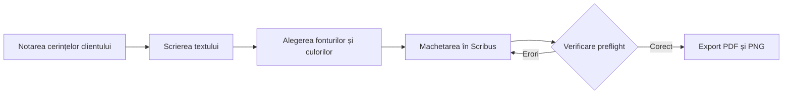

# Proiect afiș – Balul Bobocilor 2026

Acest document prezintă cerințele clientului, datele tehnice și etapele de realizare a afișului pentru evenimentul „Balul Bobocilor 2026”.

## 1. Cerințele clientului

- **Client:** Consiliul Elevilor al liceului.
- **Eveniment:** Balul Bobocilor 2026.
- **Data:** Vineri, 20 noiembrie 2026.
- **Ora:** 18:00.
- **Locul:** Sala de festivități.
- **Tema:** Anii '80.
- **Culori dorite:** Mov, roz aprins și galben.
- **Termen de predare:** 6 noiembrie 2026.
- **Număr de exemplare tipărite:** 20.
- **Publicare online:** Instagram.

**Schimbarea titlului afișului:**

~~Bal 2026~~ → **Balul Bobocilor – Anii '80**

**Elemente obligatorii:**
- Titlul evenimentului.
- Data și ora.
- Locul desfășurării.
- Sigla liceului.
- O fotografie de fundal.

## 2. Date tehnice

| Element | Tipar | Ecran |
|:---|:---:|---:|
| Dimensiune | 420 × 594 mm (A2) | 1080 × 1350 px |
| Rezoluție | 300 dpi | 96 dpi |
| Model de culoare | CMYK | RGB |
| Format | PDF/X-4 | PNG |

Afișul pentru tipar va avea orientare portret și va fi realizat în 20 de exemplare. Varianta digitală va fi pregătită pentru publicare pe Instagram.

### Calculul dimensiunii fotografiei

Formula:

$$
N = \frac{L \times R}{25,4}
$$

Unde:
- N = numărul de pixeli;
- L = lungimea laturii în milimetri;
- R = rezoluția în dpi;
- 25,4 = numărul de milimetri dintr-un inch.

**Calcul pentru afișul A2 la 300 dpi:**

Lățime:

$$
N = \frac{420 \times 300}{25,4}
= 4961 \text{ px}
$$

Înălțime:

$$
N = \frac{594 \times 300}{25,4}
= 7016 \text{ px}
$$

**Rezultat:** Fotografia trebuie să aibă minimum 4961 × 7016 pixeli.

### Textul afișului

**BALUL BOBOCILOR – ANII '80**

Pregătește-te pentru o seară plină de muzică, energie și culoare!

**20 NOIEMBRIE 2026**

**ORA 18:00**

Sala de festivități

Te așteptăm să retrăim atmosfera anilor '80!

## 3. Etape de lucru

- [x] Notarea cerințelor clientului.
- [ ] Scrierea textului afișului.
- [ ] Alegerea fonturilor și culorilor.
- [ ] Machetarea în Scribus.
- [ ] Verificarea preflight.
- [ ] Exportul PDF și PNG.

### Notă de subsol

Verificarea preflight[^preflight] este o etapă importantă înainte de tipărirea afișului.

[^preflight]: Preflight reprezintă verificarea tehnică a documentului înainte de tipărire. Se verifică dimensiunile paginii, rezoluția imaginilor, modelul de culoare, fonturile și marginile.

## 4. Diagrama etapelor

Diagrama prezintă procesul de realizare a afișului.

